<picture>
  <source media="(prefers-color-scheme: dark)" srcset="assets/profile-dark.svg">
  
</picture>

  
  
  

### Tech stack

  <a href="https://www.python.org/" title="Python"><picture>
    <source media="(prefers-color-scheme: dark)" srcset="https://skillicons.dev/icons?i=python&theme=dark">
    
  </picture></a>
  <a href="https://www.typescriptlang.org/" title="TypeScript"><picture>
    <source media="(prefers-color-scheme: dark)" srcset="https://skillicons.dev/icons?i=typescript&theme=dark">
    
  </picture></a>
  <a href="https://react.dev/" title="React"><picture>
    <source media="(prefers-color-scheme: dark)" srcset="https://skillicons.dev/icons?i=react&theme=dark">
    
  </picture></a>
  <a href="https://rubyonrails.org/" title="Rails"><picture>
    <source media="(prefers-color-scheme: dark)" srcset="https://skillicons.dev/icons?i=rails&theme=dark">
    
  </picture></a>
  <a href="https://fastapi.tiangolo.com/" title="FastAPI"><picture>
    <source media="(prefers-color-scheme: dark)" srcset="https://skillicons.dev/icons?i=fastapi&theme=dark">
    
  </picture></a>
  <a href="https://scikit-learn.org/" title="scikit-learn"><picture>
    <source media="(prefers-color-scheme: dark)" srcset="https://skillicons.dev/icons?i=sklearn&theme=dark">
    
  </picture></a>
  <a href="https://www.postgresql.org/" title="PostgreSQL"><picture>
    <source media="(prefers-color-scheme: dark)" srcset="https://skillicons.dev/icons?i=postgresql&theme=dark">
    
  </picture></a>
  <a href="https://redis.io/" title="Redis"><picture>
    <source media="(prefers-color-scheme: dark)" srcset="https://skillicons.dev/icons?i=redis&theme=dark">
    
  </picture></a>
  <a href="https://www.docker.com/" title="Docker"><picture>
    <source media="(prefers-color-scheme: dark)" srcset="https://skillicons.dev/icons?i=docker&theme=dark">
    
  </picture></a>
  <a href="https://aws.amazon.com/" title="AWS"><picture>
    <source media="(prefers-color-scheme: dark)" srcset="https://skillicons.dev/icons?i=aws&theme=dark">
    
  </picture></a>
  <a href="https://www.cloudflare.com/" title="Cloudflare"><picture>
    <source media="(prefers-color-scheme: dark)" srcset="https://skillicons.dev/icons?i=cloudflare&theme=dark">
    
  </picture></a>
  <a href="https://www.kernel.org/" title="Linux"><picture>
    <source media="(prefers-color-scheme: dark)" srcset="https://skillicons.dev/icons?i=linux&theme=dark">
    
  </picture></a>

[Jeffy](https://github.com/nicobrenner/jeffy) · [CommandJobs](https://github.com/nicobrenner/commandjobs) · [lossy-git](https://github.com/nicobrenner/lossy-git) · [n8n-nodes-jeffy](https://github.com/nicobrenner/n8n-nodes-jeffy) · [Multilingual paper](https://github.com/nicobrenner/jeffy-massive-multi-language-paper)
